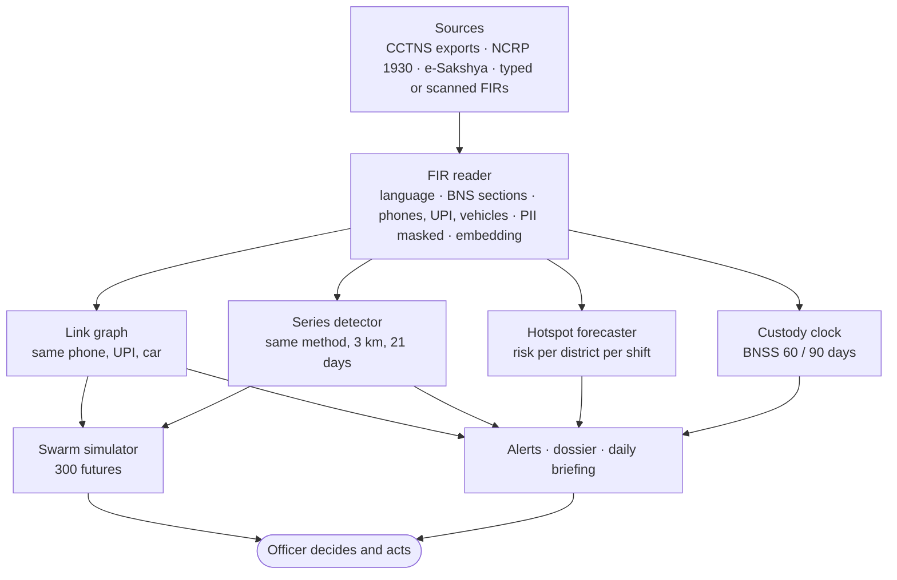

# CrimeAI

**CCTNS remembers cases. CrimeAI connects them.**

CrimeAI is an intelligence layer for Indian police stations. It reads FIRs in Indian languages, links cases that share a phone number, UPI ID, bank account or vehicle across stations, finds serial crimes by their method, forecasts risk for the next patrol shift, tracks the BNSS custody deadline for every accused, and simulates a gang's next move with and without police action. Identifiers are stored as keyed hashes and no face or biometric is ever used.

## The problem

A gang uses one phone number to cheat people in five districts. Each victim files at a different station, in a different language. Every FIR is recorded, but nobody notices it is the same number five times. Meanwhile an accused in custody walks free on default bail because the 60-day chargesheet deadline slipped.

| Gap today | What CrimeAI does |
|---|---|
| The same phone, UPI ID or vehicle appears in FIRs at several stations, unnoticed | **Link graph** joins the cases and raises one alert per identifier, with a one-click freeze-request draft |
| Serial crimes with the same method look like separate cases | **Series detector** groups cases by place, time and method, even when one FIR is in Hindi and another in English |
| FIRs arrive in many languages | **FIR reader** handles English and 12 Indian languages; **Gemini** gives any officer an English brief |
| Patrols go where they went yesterday | **Hotspot forecaster** predicts risk per district for each 6-hour shift |
| Default bail after a missed deadline | **Custody clock** counts the BNSS s.187(3) 60/90-day limit from first remand |
| "What if we act?" is guesswork | **Swarm** runs 300 simulated futures with and without patrols or a freeze on the money trail |

## How it works



| Engine | How it decides |
|---|---|
| **FIR reader** | Detects the script, then the language (marker words split Hindi from Marathi). Normalises Indic digits, finds crime, weapon, place and legal terms with lexicons, extracts vehicle numbers, phones, UPI IDs, bank accounts and amounts, maps IPC to BNS and warns when an old IPC section is cited for an incident after 1 July 2024. Aadhaar (Verhoeff-checked), phone, PAN, bank and UPI numbers are masked before any text reaches a model. Scanned FIRs are read with Tesseract OCR. |
| **Embeddings** | `intfloat/multilingual-e5-small` turns each narrative into 384 numbers, so the same method lands close together in any language. Place names are removed first; location is compared separately. Stored in PostgreSQL with pgvector. |
| **Link graph** | Every identifier becomes a node; two or more cases sharing one are joined, and chains of shared identifiers form a network. Phones, UPI IDs and accounts are stored only as an HMAC-SHA256 keyed hash. A match is a fact, not a prediction. |
| **Series detector** | Links two cases when they are the same crime type, within 3 km and 21 days, and their narratives are unusually similar for that crime type. The bar is measured on pairs that cannot share a series, and a Hindi-English pair is judged against other cross-language pairs, so a Hindi FIR can join an English series. Linked pairs are merged and pruned until every member fits. |
| **Hotspot forecaster** | A scikit-learn gradient-boosted model, the one model trained here. It predicts whether a district records a crime in each 6-hour shift from 11 inputs (recent counts, the district's usual rate, shift, weekday, month). Split by time, tested on the newest 20%, compared with a 28-day-average baseline and retrained nightly. Last run: ROC-AUC 0.645 vs 0.622 for the baseline. |
| **Risk index** | 0–100 per district from harm-weighted, recency-weighted crimes over 90 days; alerts only when a district rises to high or critical. |
| **Custody clock** | 90 days for offences punishable with death, life or 10+ years (BNS 103, 64, 70, 310 …), otherwise 60, counted from first remand in IST. Ambiguous sections are flagged "verify", never guessed. |
| **Swarm** | Gathers a case's linked network, learns its tempo, hours and places, spawns one agent per shared identifier and patrol units where they cover the most incidents, then plays 300 futures with the same random draws with and without action. It forecasts places and time windows, never people. |
| **Gemini case brief** | Google Gemini returns an English translation, summary, method, key facts, missing details and section suggestions for redacted FIR text. Each suggestion is checked against the IPC-BNS crosswalk and flagged when its reason contradicts the section's official title. |

## Screens

| Page | What it is for |
|---|---|
| Dashboard | Counts, trend, district risk and the next-24-hour shift forecast |
| Crime Map | Every incident with heat map, markers and clusters; click for crimes within 1.5 km |
| Intelligence | Crime series with the next likely window; custody deadlines; daily PDF briefing |
| Link Analysis | Network, timeline and map of cases joined by shared identifiers; freeze-request draft |
| FIR Analysis | Submit or preview an FIR; highlighted narrative, sections, identifiers, Gemini brief |
| Alerts | Link, series, risk and custody alerts, live over WebSocket |
| Patrol Routes | Risk-weighted, coverage or shortest routes on real roads (OSRM) |
| Swarm | Simulated futures of a network, with patrol and freeze levers |
| Simulation | District-level what-if for patrols, CCTV, curfew |
| Integrations | How CrimeAI connects to CCTNS, NCRP, e-Sakshya and ICJS; file import |
| Case Dossier | Custody countdown, linked identifiers, similar cases in any language, e-Sakshya evidence |
| Admin | Access requests, users, audit log, model training, system health |

## Run it locally

One command installs Docker if needed, builds everything, loads demo data, trains the models and opens the app:

```bash
start.cmd        # Windows
./start.sh       # macOS / Linux
```

It prints `http://localhost:5173` and the demo login (`admin@crimeai.example`; the password is saved in `crimeai/backend/var/demo-credentials.txt`). Other roles: `analyst@`, `police@`, `readonly@crimeai.example`. The first run downloads about 3 GB.

**Gemini (optional):** create `crimeai/backend/.env` with `GEMINI_API_KEY=your-key` from [Google AI Studio](https://aistudio.google.com/apikey) and run `start.cmd` again. Without a key the feature is hidden and nothing leaves the server.

## Deploy on Google Cloud

One VM runs the whole stack with HTTPS. On your machine:

```bash
gcloud compute instances create crimeai --zone=asia-south1-a --machine-type=e2-standard-4 \
  --image-family=ubuntu-2204-lts --image-project=ubuntu-os-cloud --boot-disk-size=60GB \
  --tags=http-server,https-server
gcloud compute firewall-rules create crimeai-web --allow=tcp:80,tcp:443 --target-tags=http-server,https-server
gcloud compute ssh crimeai --zone=asia-south1-a
```

On the VM:

```bash
git clone https://github.com/RudreshRajvansh/CrimeAI.git && cd CrimeAI
GEMINI_API_KEY=your-key bash deploy/deploy.sh
```

The script installs Docker, generates secrets, serves the app at `https://<external-ip>.sslip.io` with a Let's Encrypt certificate (or set `DOMAIN=your.domain`), loads the demo data and prints the URL and login. The first build takes 10–20 minutes. The production stack (`crimeai/docker-compose.prod.yml`) runs Caddy with the built frontend, the API, a Celery worker and scheduler, PostgreSQL (PostGIS + pgvector) and Redis.

## Privacy, law and safety

- No face recognition or biometrics; forecasts describe places and shifts, never people.
- Phone, UPI and account numbers are stored only as keyed hashes; PII is masked before any model or Gemini sees text.
- Every sensitive read (full identifier, proof file, Gemini call, admin action) goes to an audit log the database refuses to edit or truncate.
- Roles (read-only < analyst < police < admin) are checked on the server; sessions use short-lived tokens with rotating, revocable refresh cookies.
- Follows BNS 2023 (IPC mapping), BNSS s.187(3) (default bail) and s.105 (e-Sakshya recordings).
- Every link, series and letter is a proposal; an officer confirms and acts.

## Data

The app runs on synthetic data: 18 months of Delhi incidents across 9 districts with real-world time patterns, plus hidden scenarios the engines find without being told (a three-cell cyber-fraud syndicate, a burglary gang tied by one car, a two-wheeler theft ring, a chain-snatching pair reported in Hindi and English, trader extortion, and custody cases on both deadline tracks). FIRs are written in 13 languages.

`FIR_Organized_5Languages/` holds real-format FIR sample images in Bengali, English, Hindi, Marathi and Tamil, used to test and improve the OCR and FIR reader.

## Tech stack

FastAPI (async Python) · SQLAlchemy 2 · PostgreSQL 16 + PostGIS + pgvector · Redis · Celery · scikit-learn · sentence-transformers (multilingual-e5) · Google Gemini · spaCy · Tesseract · React 18 + TypeScript + Vite + Tailwind · Leaflet · force-directed graph · Docker Compose · Caddy

## Tests

```bash
cd crimeai/backend
pip install -r requirements-dev.txt
pytest tests/unit            # no services needed
pytest tests/integration     # needs PostgreSQL (PostGIS + pgvector) and Redis; DATABASE_URL must name a *_test database
```

CI runs linting, 330+ backend tests, migrations up and down, the frontend type-check, lint and build, and dependency audits.

## Repository layout

```
crimeai/
  backend/       FastAPI app: api, services, ml (forecast, risk, clustering, similarity, series),
                 nlp (multilingual reader, IPC-BNS crosswalk, redaction, Gemini), workers, migrations, tests
  frontend/      React app, production Dockerfile and Caddyfile
  docker-compose.dev.yml    local stack
  docker-compose.prod.yml   production stack
deploy/deploy.sh            one-command VM deployment
FIR_Organized_5Languages/   FIR sample images in 5 languages
start.cmd / start.sh        one-command local start
```
